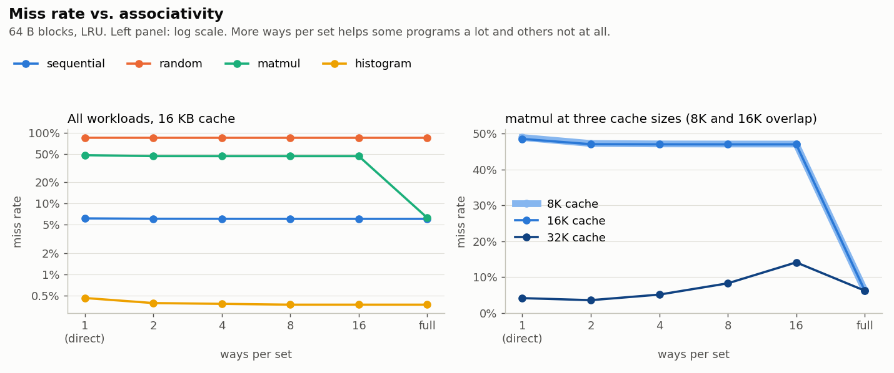
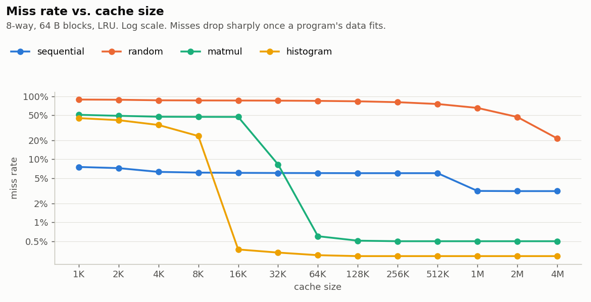
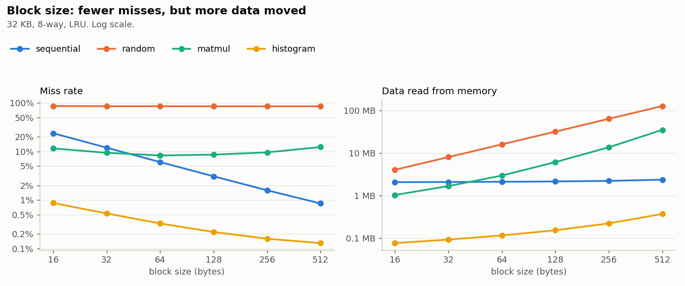
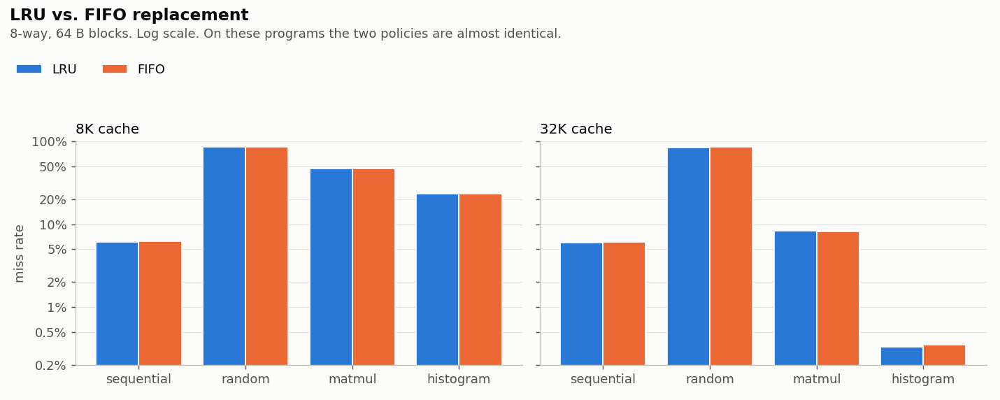
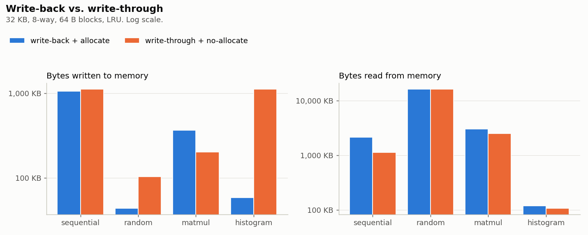
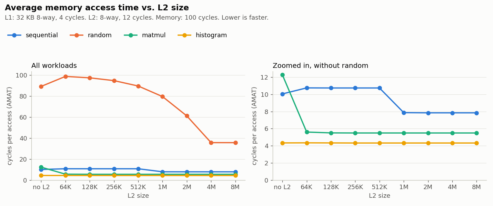

# Cache Simulator

A CPU cache simulator written in C++. It reads a memory trace (the list of addresses a program
accesses, as recorded by Valgrind), simulates how a cache would handle each access, and reports
the hit and miss rates.

## Features

- Configurable cache size, block size, and associativity (direct-mapped to fully associative)
- LRU and FIFO replacement
- Reads Valgrind `lackey` traces
- Separate hit/miss counts for reads (loads) and writes (stores)
- Write-back or write-through, with write-allocate or no-write-allocate, and a count of bytes moved to and from memory
- Optional second cache level (L2) with its own settings
- Average memory access time (AMAT), from configurable L1, L2, and memory latencies
- Sample workloads plus a script that records their traces with Valgrind
- Experiments that sweep each setting across all workloads and graph the results ([below](#experiments))
- Validated against Valgrind's Cachegrind: L1 miss counts agree within 0.06% ([below](#validation-against-cachegrind))

### Roadmap
- [ ] Model block transfer time, so memory cost grows with block size

## Building

```bash
make            # Linux / macOS / WSL
build.bat       # Windows (MinGW)
```

## Testing

```bash
./tests/run_tests.sh
```

Builds the simulator and runs it on small traces whose hit/miss counts were worked out by hand
(direct-mapped vs. 2-way, LRU vs. FIFO, Valgrind `M` and `I` lines).

## Usage

```
cachesim [options] <trace-file>

L1 options:
  -s SIZE    cache size, e.g. 32K, 1M     (default 32K)
  -b BYTES   block size                   (default 64)
  -a WAYS    associativity, or "full"     (default 8)
  -p POLICY  lru | fifo                   (default lru)
  -w POLICY  wb (write-back) | wt (write-through)          (default wb)
  -W POLICY  wa (write-allocate) | nwa (no-write-allocate)
             on a write miss                 (default wa for wb, nwa for wt)
  -L CYCLES  hit time                     (default 4)

L2 options (L2 is only added if you give at least one of these):
  --l2-size SIZE     (default 256K)      --l2-policy POLICY  (default lru)
  --l2-block BYTES   (default 64)        --l2-write POLICY   (default wb)
  --l2-assoc WAYS    (default 8)         --l2-alloc POLICY
  --l2-lat CYCLES    (default 12)

Other:
  --mem-lat CYCLES  main memory access time   (default 100)
  -i                include instruction fetches ('I' lines)
```

Example with a tiny direct-mapped cache:

```
$ ./cachesim -s 64 -b 16 -a 1 examples/sample.trace
L1 cache:      64 B, 16 B blocks, 1-way, 4 sets, LRU, 4-cycle hit
write policy:  write-back + write-allocate
address:       tag | 2 index bits | 4 offset bits
accesses:      7
  reads:       6
  writes:      1
hits:          2
misses:        5
  read misses: 5
  write misses: 0
hit rate:      28.57%
miss rate:     71.43%
dirty evictions: 1

memory:        100-cycle access
memory traffic:
  bytes read:    80
  bytes written: 16

total cycles:  528
AMAT:          75.43 cycles per access
```

With an L2 cache under L1:

```bash
./cachesim -s 32K --l2-size 256K traces/matmul.trace
```

## Getting traces

Traces are recorded with Valgrind on Linux or WSL (`sudo apt install valgrind`).

The `workloads/` folder has small C programs with different memory access patterns:

| Program | Access pattern |
|---|---|
| `sequential.c` | fills and sums a 1 MB array front to back |
| `random.c` | 256K reads from random spots in a 4 MB array |
| `matmul.c` | 64 x 64 matrix multiply (reads one matrix across rows, the other down columns) |
| `histogram.c` | 256K increments into 4096 counters (write-heavy) |

Record all of them into `traces/`:

```bash
./scripts/make_traces.sh
./cachesim traces/matmul.trace
```

Or trace any program of your own:

```bash
valgrind --tool=lackey --trace-mem=yes --log-file=prog.trace ./your_program
```

## Experiments

`experiments/run_experiments.py` runs the simulator about 170 times, changing one setting at a time,
on all four workloads. The raw numbers are in `results/*.csv`.

```bash
./scripts/make_traces.sh                  # in WSL/Linux: record the traces
python experiments/run_experiments.py     # about 30 seconds
```

Unless a graph says otherwise, L1 is 32 KB, 8-way, 64 B blocks, LRU, write-back.

### Associativity



- **matmul** misses about 47% of the time in a 16 KB cache at every associativity up to 16-way, then drops to 6%
  when fully associative. Walking down a column of a 64 x 64 matrix of doubles jumps 512 bytes (8 blocks) each step,
  so the column only ever lands in a few sets, and those sets thrash while the rest of the cache sits empty.
  These are **conflict misses**, which only more ways (or a different layout) can fix.
- At 32 KB, matmul is not even monotonic: 2-way (3.6%) beats 8-way (8.3%) and 16-way (14.1%).
  More associativity is not automatically better.
- **sequential**, **random**, and **histogram** barely change: their misses come from data that is used once,
  too big, or already fits, none of which associativity helps.

### Cache size



Each program's miss rate falls sharply once the cache can hold its **working set** (the data it's actively using):
histogram's 16 KB of counters at 16 KB (23% → 0.4%), matmul's 96 KB of matrices between 32 KB and 64 KB
(47% → 0.6%), and sequential's 1 MB array at 1 MB (6% → 3%, because the second pass over the array now hits).
random's 4 MB array never fully fits.

### Block size



- **sequential** halves its miss rate every time the block size doubles (24% at 16 B → 0.85% at 512 B),
  because it uses every byte of every block.
- **random** gains nothing (85% at every size) but drags in 32x more data (4 MB → 127 MB).
- **matmul** is best at 64 B (8.3%). Bigger blocks mean fewer of them fit, and it gets worse again (12.3% at 512 B).

### LRU vs. FIFO



On these programs the two policies are within 0.1 percentage points of each other. Their misses are dominated by
data that doesn't fit or isn't reused, which no replacement policy can fix.

### Write-back vs. write-through



- **histogram** keeps updating the same counters: write-back writes **58 KB** to memory, write-through **1,127 KB** (19x more).
- **sequential** writes each element once: write-through + no-write-allocate *reads* half as much (1.1 MB vs. 2.2 MB),
  because it never fetches blocks it's only going to overwrite.

### L2 cache and AMAT



- **matmul** runs 55% faster with any L2 of 64 KB or more (12.3 → 5.5 cycles per access): its data doesn't fit in L1 but fits in L2.
- **random** and **sequential** get *slower* with a small L2 (random 89 → 99 cycles with 64 KB). Every L1 miss now
  pays 12 extra cycles to check an L2 that almost never has the data. L2 only pays off once it can hold the working set
  (random: 36 cycles with a 4 MB L2).
- **histogram** doesn't care: it already fits in L1.

## Validation against Cachegrind

Valgrind ships its own cache simulator, Cachegrind. `scripts/validate_cachegrind.sh` runs it and cachesim on
the same four programs with the same L1 settings (LRU, write-allocate) and compares the number of data misses:

```bash
./scripts/validate_cachegrind.sh     # in WSL/Linux, about 30 seconds
```

| L1 configuration | Largest difference (any workload) |
|---|---|
| 32 KB, 8-way, 64 B blocks | 1 miss (0.05%) |
| 16 KB, direct-mapped, 64 B blocks | 1 miss (0.03%) |
| 8 KB, 4-way, 32 B blocks | 4 misses (0.004%) |
| 16 KB, fully associative, 64 B blocks | 1 miss (0.05%) |

All 16 results are in `results/cachegrind_validation.csv`. Access totals differ slightly because Cachegrind counts
a modify (e.g. `x++`) as one access while cachesim counts a read and a write; the write always hits, so miss
counts are unaffected.

One lesson from getting this to agree: the first attempt was off by up to 13% on direct-mapped caches. The cause
wasn't the simulator. The trace and the Cachegrind run were started from different directories, which changes
the environment variables on the program's stack and shifts every stack address. In a direct-mapped cache that's
enough to change which data collide. The script now records its own trace and runs Cachegrind under identical
conditions.

## How it works

Each address is split into three parts: `[ tag | set index | block offset ]`.
The set index picks which set to look in. Each line in that set is checked for a matching tag.
On a miss, an empty line is filled if there is one. Otherwise a line is evicted:
the least recently used one (LRU) or the oldest one (FIFO).
